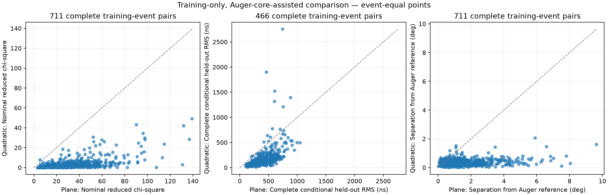

# Training-pilot baseline report

Run: `training_pilot_20261011_v1`. Configured training events: **711**; previously examined development events: **19**.

This is an Auger-core-assisted training/development comparison, not independent validation or a measurement of true-direction accuracy. No protected checkpoints or raw event files are read by this reporting module.

## Checkpoint and fit accounting

Event checkpoint statuses: `{"complete": 711}`.

| Timing-weighted method | Full success / configured | Complete held-out events | Any quality flag | Observed influence >1 degree |
|---|---:|---:|---:|---:|
| plane | 711 / 711 | 711 | 711 | 595 |
| quadratic | 711 / 711 | 466 | 711 | 131 |

## Paired observations

- `reduced_chi_square`: 711 complete pairs; quadratic lower in 710, plane lower in 1, equal in 0; 0 incomplete.
- `rms_residual_ns`: 711 complete pairs; quadratic lower in 711, plane lower in 0, equal in 0; 0 incomplete.
- `separation_from_auger_deg`: 711 complete pairs; quadratic lower in 650, plane lower in 61, equal in 0; 0 incomplete.
- `heldout_rms_ns`: 466 complete pairs; quadratic lower in 452, plane lower in 14, equal in 0; 245 incomplete.
- `heldout_normalized_mse`: 466 complete pairs; quadratic lower in 439, plane lower in 27, equal in 0; 245 incomplete.
- `maximum_loo_direction_shift_deg`: 466 complete pairs; quadratic lower in 445, plane lower in 21, equal in 0; 245 incomplete.

## Interpretation and limitations

CSV summaries report median, p68 and p95 with metric-specific eligible-event counts. Each event has equal weight: station residuals are summarized within an event before cross-event summaries. Previously examined and remaining training events are also reported separately, alongside actual station-multiplicity groups 6, 7–9, 10–19, 20+, under 6, and unknown (including failures with no validated station count). Missing/failed events are retained; no quality flag or influence warning excludes an event from primary metrics.

Full-fit reduced chi-square is nominal, especially at the nonnegative curvature boundary. Uniform fits do not minimize physical chi-square. Held-out normalized MSE uses detector timing uncertainties only and is neither reduced chi-square nor a calibrated predictive pull. Complete held-out metrics require every station fold to succeed and yield a prediction. Maximum observed influence from incomplete folds is a lower bound; only complete influence values enter quantile summaries.

A lower separation means closer agreement with Auger's published direction, not proof of improvement relative to physical truth or superiority over Auger. The core and station selection are reused from the full official reconstruction, so station holdout is conditional rather than independent end-to-end validation. Win counts alone do not establish statistical significance. Failures and flagged outcomes must be examined before promoting or tuning a model.

